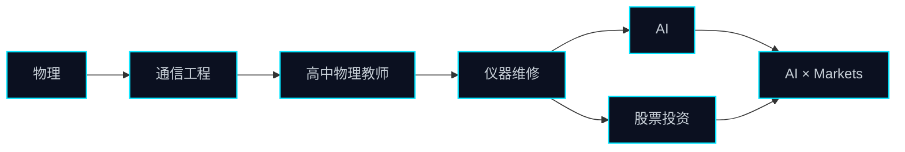

<div align="center">
  
</div>

<div align="center">
  
  
  
</div>

<div align="center">
  
  
  
  
  
  
  
  
  
  
</div>

### `$ whoami`

```text
C0S1N3
通信工程 / 前高中物理教师 / 仪器维修 / AI × 股票投资爱好者
```

> 非 985/211；频谱仪不查学历，信号只看频谱。

### `$ cat /proc/c0s1n3`

```text
EDU      某双非理工大学 · 通信工程（本科）
PAST     高中物理教师
NOW      仪器维修 / 故障诊断
BENCH    示波器 · 万用表 · 焊台 · 校准
AI       LLM agents · 本地模型 · 实验
MARKETS  股票投资 / 把市场当信号
STATUS   still calibrating
```

### `$ ./signal_chain --trace`



> 先测量，再维修。先复现，再优化。先把噪声降下来，再谈收益。

### `$ cat ~/.plan`

```text
[ ] 让 AI 读懂一张电路图
[ ] 用回测验证一个想法，而不是用想法解释回测
[ ] 修好那台“用来修仪器”的仪器
[ ] 把物理解释到高中生也能听懂
```

### `$ ls -la ~/interests`

| channel | note |
| --- | --- |
| AI | 把模型当新的示波器：先观察，再下结论。 |
| Markets | 市场是噪声最大的信号源；先降噪，再谈收益。 |
| Instruments | 能复现的故障，才叫修好。 |
| Physics | 把复杂系统讲简单，是另一种调试。 |

### `$ ./selected_builds --list`

| build | signal | stack |
| --- | --- | --- |
| [scan-watermark-removal](https://github.com/C0S1N3/scan-watermark-removal) | 扫描件像素级降噪：确定性去水印，保留笔迹 | Python / NumPy / Pillow |
| [boardgame-rulebook-zh](https://github.com/C0S1N3/boardgame-rulebook-zh) | 桌游规则书原位汉化：只擦字、不动图 | PyMuPDF / Pillow |
| [pata](https://github.com/C0S1N3/pata) | 《爬塔》— Slay the Web 简体中文版 | JavaScript |

<div align="center">
  <a href="https://github.com/C0S1N3?tab=repositories"><sub>MORE REPOSITORIES →</sub></a>
</div>

### `$ stats --github`

<div align="center">
  
  
</div>

### `$ cat ~/.contact`

```text
GitHub Issues / PR — 最可靠的一根信号线。
If you're into physics, signals, instruments, AI agents, or markets, open a channel.
```

<div align="center">
  <sub>README.md // v1.0 // calibrated 2026-10 // keep measuring.</sub>
</div>
