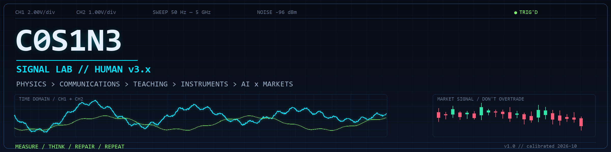
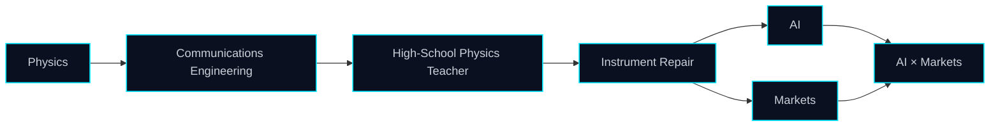

<div align="center">
  
</div>

<div align="center">
  
  
  
</div>

<div align="center">
  
  
  
  
  
  
  
  
  
  
  
  
  
</div>

### `$ whoami`

```text
cosmo (@C0S1N3)
Communications Engineering / Former High-School Physics Teacher / Instrument Repair / AI & Markets
```

> Non-985/211 university. No elite badge — the spectrum analyzer doesn't check diplomas; it reads the spectrum.

### `$ cat /proc/c0s1n3`

```text
EDU      Non-985/211 university · B.Eng. in Communications Engineering
PAST     High-school physics teacher
NOW      Instrument repair / fault diagnosis
BENCH    Oscilloscope · DMM · soldering · calibration
AI       LLM agents · local models · experiments
MARKETS  Stock investing / market as a signal
PLAY     Board games · Honor of Kings
STATUS   still calibrating
```

### `$ ./signal_chain --trace`



> Measure first, repair second. Reproduce first, optimize second. Filter the noise before talking returns.

### `$ git log --oneline --graph --decorate`

```text
* 9f3a1c2 (HEAD -> cosmo) feat: instrument repair / fault diagnosis
* 4b7d0e1 refactor: high-school physics teacher
* 2c9a8f0 feat: B.Eng. communications engineering
* 1a0b3d4 init: curiosity
```

```text
$ uptime
up 3 career pivots, 2 pending experiments, 1 calibrated bench, 0 unhandled exceptions
```

### `$ cat ~/.plan`

```text
[ ] Teach an AI to read a schematic
[ ] Validate an idea with a backtest, not a backtest with an idea
[ ] Repair the instrument that repairs instruments
[ ] Explain physics well enough for a high-schooler again
[ ] Play a board game without rewriting the rulebook
[ ] Stop queuing ranked after two losses
```

### `$ dmesg | tail -5`

```text
[  OK  ] mounted /dev/curiosity
[  OK  ] calibrated oscilloscope
[  OK  ] loaded ai_agents.ko
[ WARN ] market noise above threshold
[  OK  ] queued board_game_night
```

### `$ top -u cosmo`

```text
PID   %CPU  COMMAND
001   37.0  ai_agents --experimental
002   24.0  markets --research
003   18.0  instrument_repair --bench
004   11.0  honor_of_kings --ranked
005   10.0  board_games --rulebook
```

### `$ ls -la ~/interests`

| channel | note |
| --- | --- |
| AI | Treat the model as a new oscilloscope: observe first, conclude second. |
| Markets | The market is the noisiest signal source. Filter first; talk returns later. |
| Instruments | A fault is only fixed when it can be reproduced. |
| Physics | Making a complex system simple is another form of debugging. |
| Board games | BGA/BGG regular; rulebooks, localization, and table chaos. |
| Honor of Kings | Ranked queue as risk control, tilt management, and teamwork practice. |

### `$ cat ~/.now`

```text
building   AI agents that can read a schematic
testing    market ideas with paper backtests
repairing  something with a broken power rail
playing    Honor of Kings (ranked) / board games (BGA)
reading    The Art of Electronics / The Signal and the Noise / Thinking in Systems
```

### `$ ./selected_builds --list`

| build | signal | stack |
| --- | --- | --- |
| [scan-watermark-removal](https://github.com/C0S1N3/scan-watermark-removal) | Deterministic pixel cleanup for scans: remove the watermark, keep the ink. | Python / NumPy / Pillow |
| [boardgame-rulebook-zh](https://github.com/C0S1N3/boardgame-rulebook-zh) | In-place rulebook localization: erase the text, never move the art. | PyMuPDF / Pillow |
| [pata](https://github.com/C0S1N3/pata) | Slay the Web — a Simplified Chinese localization. | JavaScript |

<div align="center">
  <a href="https://github.com/C0S1N3?tab=repositories"><sub>MORE REPOSITORIES →</sub></a>
</div>

### `$ stats --github`

<div align="center">
  
  
</div>

### `$ cat ~/.contact`

```text
GitHub Issues / PR — the most reliable signal line.
If you work on physics, signals, instruments, AI agents, or markets, open a channel.
```

<div align="center">
  <sub>README.md // v1.4 // calibrated 2026-10 // keep measuring.</sub>
</div>
